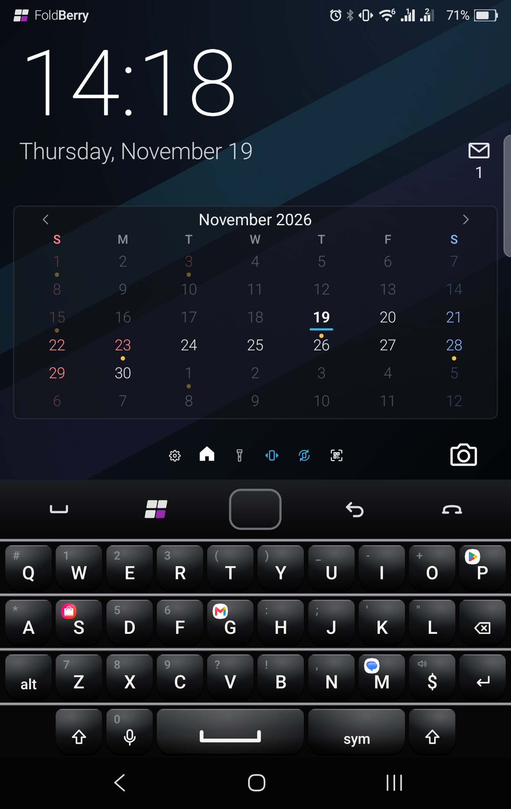
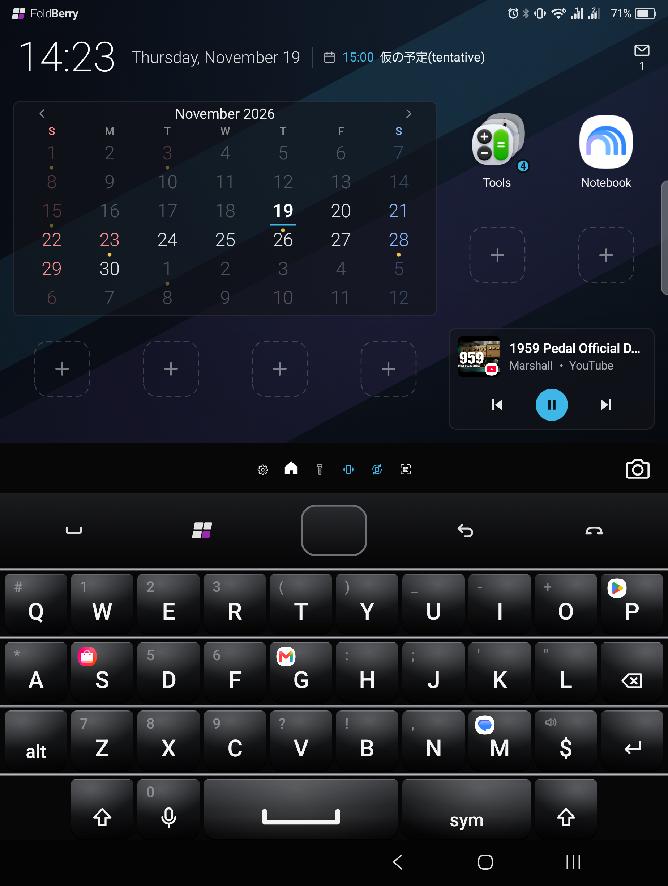
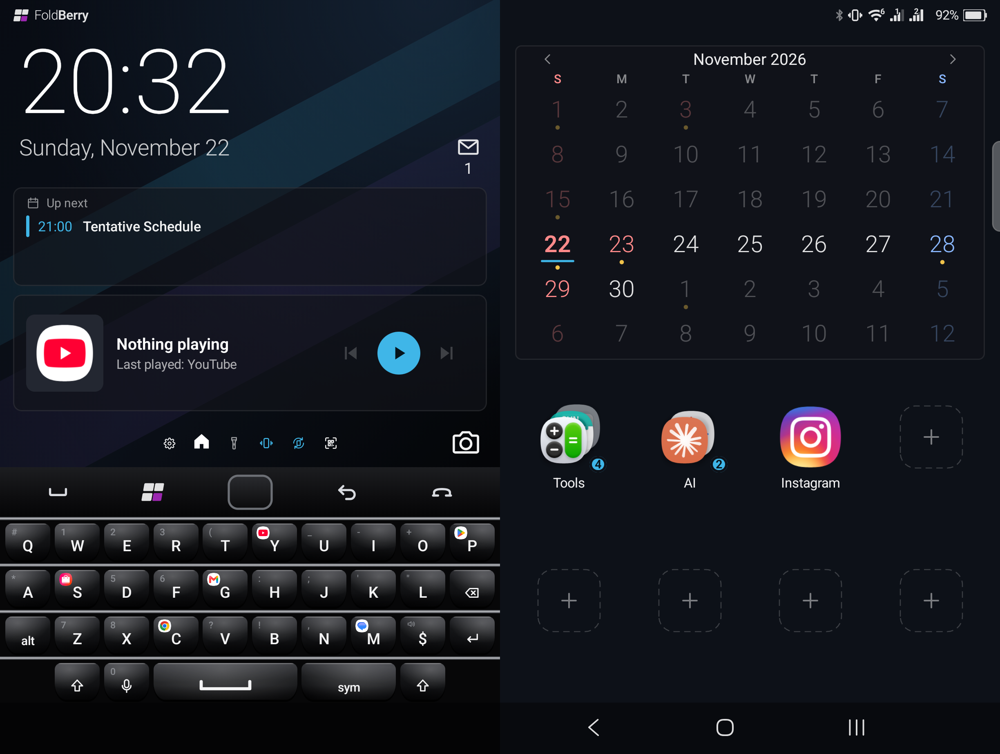
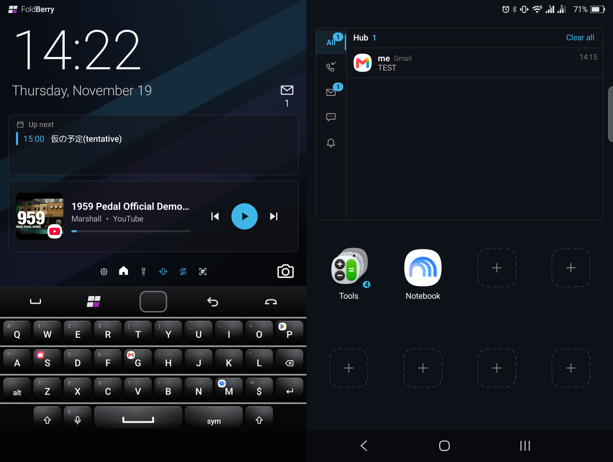
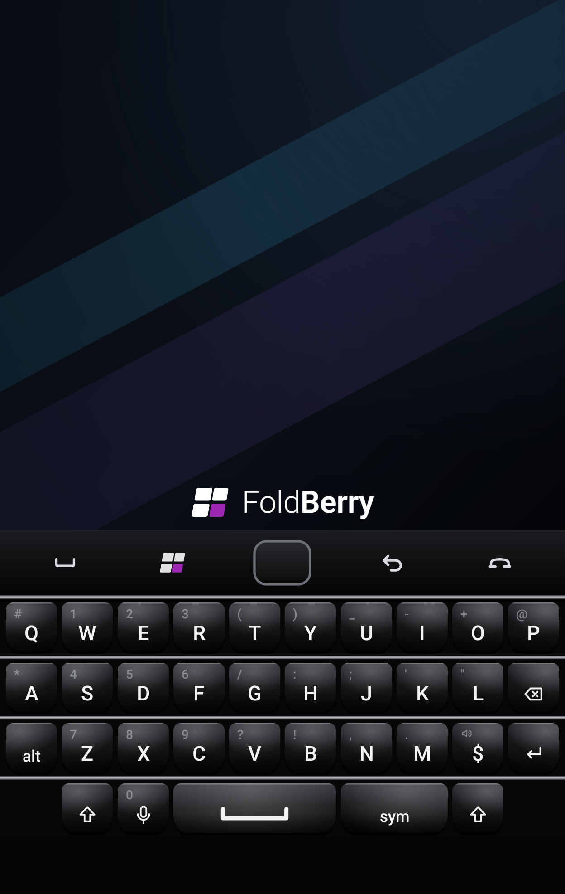
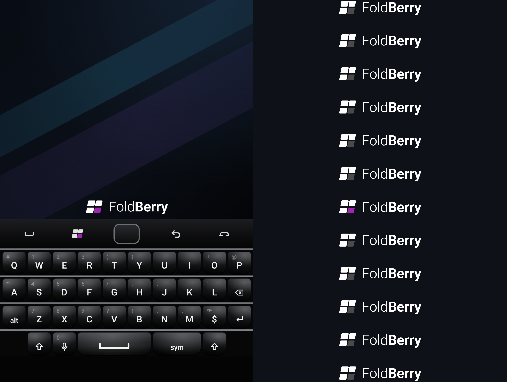

English | [日本語](README.md)

# FoldBerry

A home app (launcher) that recreates a BlackBerry handset (Classic / BB10 era) on the screens of the Galaxy Z Fold8.
The physical-style QWERTY keyboard drawn on screen is not for typing — each key is an **app launcher key**.

> FoldBerry is an unofficial fan-made app. It is not affiliated with BlackBerry Limited or Samsung Electronics.

<p align="center">
  
  &nbsp;
  
</p>
<p align="center">Left: cover screen / Right: main screen (portrait)</p>
<p align="center">
  
  &nbsp;
  
</p>
<p align="center">Main screen (landscape) Left: calendar / Right: Hub</p>

## Features

- **Launch apps with keys**: Assign any app to 35 keys (letter keys, symbol keys, etc.) and tap to launch it. Long-press a key to change its assignment (in the voice build, the 0 key's long-press starts voice control instead; change its assignment from the assignment list in the settings).
- **Function row**: Send (phone), Menu (settings), Trackpad (app list), Back, and End (go home). Send, Back and End can also be assigned to apps.
- **Cover screen and main screen**: The layout switches as you fold and unfold. Assignments are shared between both.
- **BB10-style screen area**: A custom status row (Wi-Fi, per-SIM signal, Bluetooth, battery), a clock with notification counts by type, a monthly calendar with dots on days that have events, and a shortcut row (flashlight, silent mode, auto-rotate, QR, camera). An icon in the status row shows when an alarm is set.
- **Music and up next**: Control the music that's playing (play, pause, previous, next) and see your next two events for today and tomorrow.
- **Hub**: Show your notification list in place of the calendar (swipe the header down to flip between them). Swipe a row sideways to clear it, or tap "Clear all" to clear the notifications shown.
- **App list**: A paged app list. Filter apps by name with the search field at the top. Assigned apps get a badge. Long-press to assign, open app info, or uninstall.
- **App shortcuts**: Items you get by long-pressing an app icon, such as Gmail's "Compose", can also be assigned to keys and slots (tap › next to an app in the assignment sheet, or use the long-press menu in the app list). Available only while FoldBerry is your default home app.
- **Folders**: Put folders holding up to 4 apps into the free slots on the main screen.
- **Voice control (voice build only)**: Voice control is experimental and only in the "voice build" on the `feature/voice` branch (not in the FoldBerry.apk on Releases). Long-press the 0 key (the one with the mic) and speak to open apps, set alarms and timers, call someone (opens the dialer with their number), turn the flashlight or vibrate mode on and off, assign or clear a letter key ("Assign Gmail to the G key"), open FoldBerry settings, and switch between the calendar and Hub. Works in Japanese and English, and listening happens only on the device (see "Privacy" below).
- **Settings**: Background (presets or your photo), language (日本語 / English), voice language (voice build only), clock format, haptics on/off, assignment list, export/import of settings.

## Requirements

| Item | Details |
|---|---|
| Device | Galaxy Z Fold8 (the only device tested) |
| OS | Android 15 or later (minSdk 35) |

It may also work on the Galaxy Z Fold Ultra, another foldable, but it has not been tried, so this is unknown.
It should start on other foldables or regular phones, but this is untested and the layout may break.

## Installation

1. Download `FoldBerry.apk` from the [latest release](https://github.com/huskyvoice/foldberry/releases/latest) to your device ([direct download](https://github.com/huskyvoice/foldberry/releases/latest/download/FoldBerry.apk)).
2. Open the file on your device and install it. If asked to allow "unknown apps", allow it for the app you downloaded with (e.g. your browser).
3. Select FoldBerry under Settings → Apps → Default apps → Home app. You can also open this screen from FoldBerry's settings (Menu key) → "Default home app".

To update, download the new `FoldBerry.apk` from Releases and install it over the old one. Your assignments and settings are kept.

> **Note**: Uninstalling deletes your assignments and settings (they are not included in device backups). Before uninstalling or switching devices, save them to a file with "Export settings" in the settings.

## Lock screen wallpaper

Wallpapers made for the lock screens of the cover screen and the main screen are included. They show FoldBerry's background and keyboard with the logo, so unlocking flows straight into the FoldBerry home screen.
The main screen version has the same picture as the cover version on the left half, and a column of logos on the right half where only the one at the same height as the left logo is in color.

<p align="center">
  
  &nbsp;
  
</p>
<p align="center">Left: cover screen / Right: main screen</p>

| Screen | File | Size |
|---|---|---|
| Cover screen | [`wallpaper/FoldBerry-lockscreen-cover.png`](wallpaper/FoldBerry-lockscreen-cover.png) | 1248×1972 |
| Main screen | [`wallpaper/FoldBerry-lockscreen-main.png`](wallpaper/FoldBerry-lockscreen-main.png) | 2448×1848 (landscape) |

Save them to your device and set each one as the lock screen wallpaper of its screen.

## Initial setup (optional)

All of the following permissions are optional. If you don't grant one, only the related indicator is hidden; everything else keeps working.

| Permission | Used for | How to grant |
|---|---|---|
| Nearby devices / Phone | Bluetooth and per-SIM signal in the status row | Dialog on first launch (change later in App info) |
| Notification access | Notification counts next to the clock, Hub, music controls | Settings → "Show notification counts" opens the permission screen |
| Calendar | Up next, calendar dots | Tap the events area ("Show events") to get the prompt |
| Modify system settings | Auto-rotate in the shortcut row | The permission screen opens the first time you tap auto-rotate |
| Microphone | Voice control (voice build only) | Prompt the first time you long-press the 0 key |
| Contacts | "Call …" in voice control (voice build only) (finds the number by name) | Prompt the first time you say "Call …" |

## Privacy

FoldBerry **never connects to the internet** (it does not have the Internet permission).
Notification contents, the app list, your assignments and other data are used only on your device and are never sent anywhere.
There are no ads, analytics, or crash reporting.

### Voice control and downloading the speech model (voice build only)

This section applies only to the voice build on the `feature/voice` branch. The FoldBerry.apk on Releases does not use speech recognition and never downloads a speech model.

Voice control listens only on the device (it never switches to a recognition service that sends your voice elsewhere). So it only works when the speech model for the language you speak is on the device.

When you press "Download" on the voice card, it's not FoldBerry but the device's **Android System Intelligence** (a Google system app) that fetches the speech recognition model for that language from Google's servers. Nothing is downloaded until you press it.

| Item | Details |
|---|---|
| What is downloaded | One speech recognition model for the "Voice language" setting (default: the display language) — Japanese (ja-JP) or English (en-US) |
| From | Google (received by Android System Intelligence; according to Google's published description, through Private Compute Services) |
| Stored in | Android System Intelligence's own app storage (not visible to you or other apps) |
| Size | Shown on the device's confirmation screen before the download. Afterwards, check it in Settings → Apps → Android System Intelligence → Storage |
| Removing it | Clear its data from the same screen (this may also clear data for other Android System Intelligence features) |

If you don't download it, only voice control is unavailable; everything else keeps working. FoldBerry itself still never connects to the internet.

## Building it yourself

Everything is built inside a Docker container. All you need on your PC is Docker (and Git Bash on Windows).

```sh
scripts/fb.sh doctor     # check the environment
scripts/fb.sh keygen     # create a signing key (first time only)
scripts/fb.sh check      # lint and unit tests
scripts/fb.sh build      # release build -> dist/FoldBerry.apk
```

To install over wireless debugging (the IP and ports are shown on the device's "Wireless debugging" screen):

```sh
scripts/fb.sh pair <IP> <pairing port> <code>   # first time only
scripts/fb.sh connect <IP> <connection port>
scripts/fb.sh install
```

An APK you build yourself is signed with your own key, so it cannot be installed over the distributed `FoldBerry.apk` (uninstall it first).

The script messages and source code comments are in Japanese.

## Trademarks and disclaimer

- BlackBerry is a trademark of BlackBerry Limited. Galaxy and Galaxy Z Fold are trademarks of Samsung Electronics Co., Ltd. Other names are trademarks of their respective owners.
- FoldBerry is not developed, endorsed, or supported by any of the companies above. It does not use the BlackBerry logo or any official assets; all icons and key designs are original.
- This software is provided without warranty. The author is not liable for any damages arising from its use (see [LICENSE](LICENSE)).

## License

[MIT License](LICENSE)
