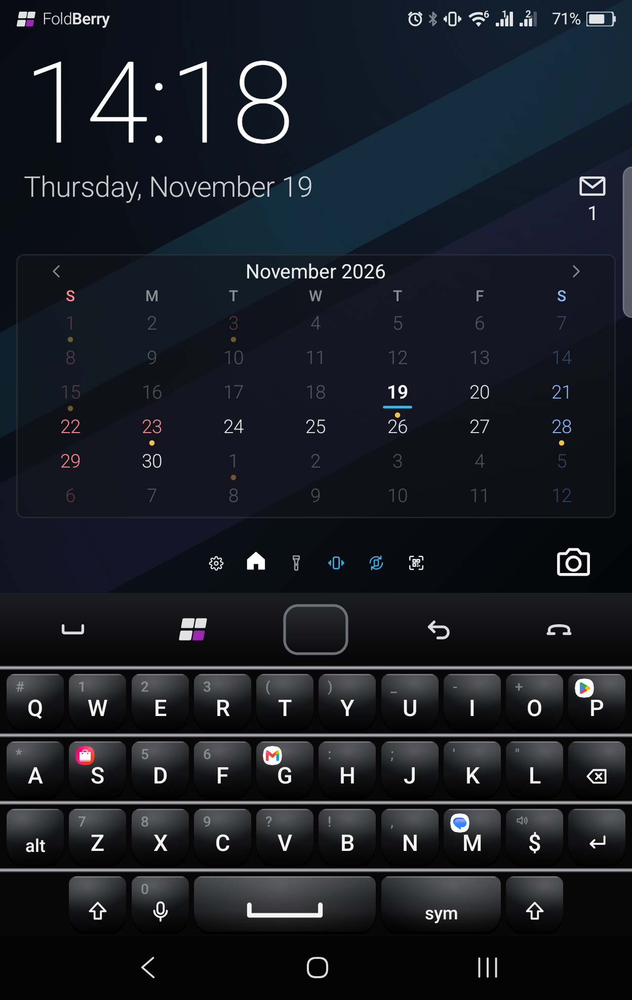
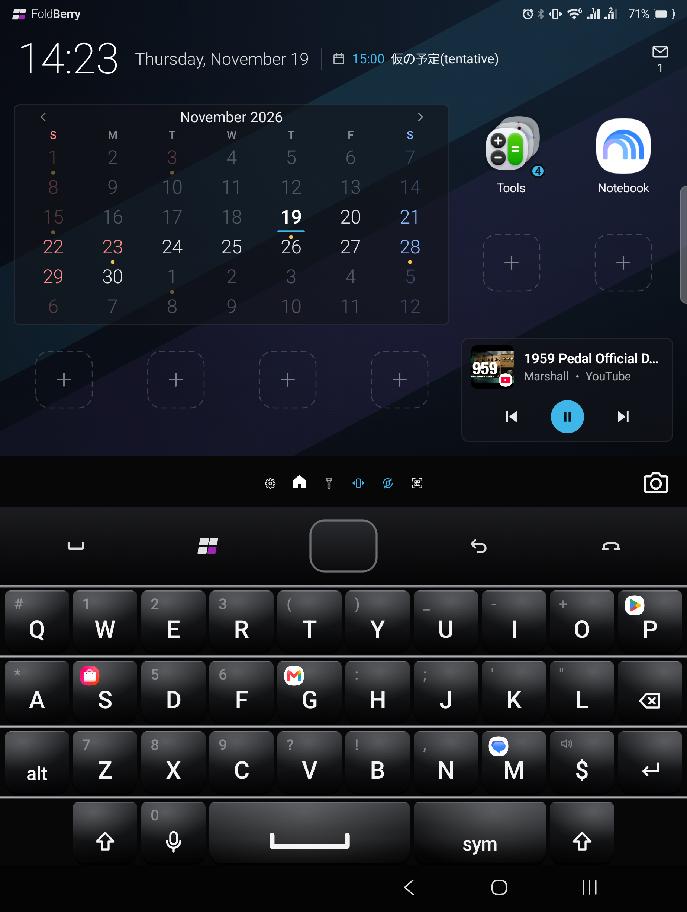
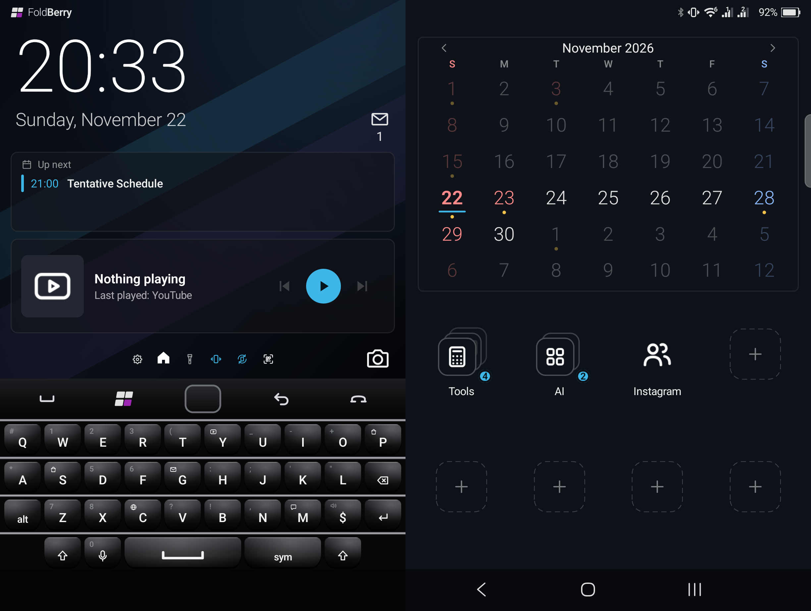
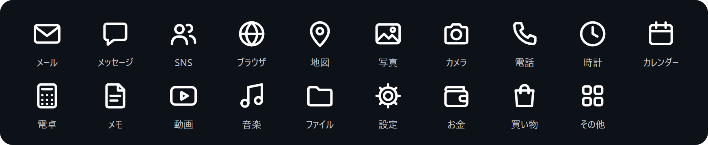

[English](README.en.md) | 日本語

# FoldBerry

Galaxy Z Fold8 の画面に、BlackBerry(Classic / BB10 世代)の本体を再現するホームアプリ(ランチャー)です。
画面に描いた物理 QWERTY キーボードを、文字入力ではなく「アプリを起動するキー」として使います。

> FoldBerry は非公式のファンメイドアプリです。BlackBerry Limited、Samsung Electronics とは一切関係ありません。

<p align="center">
  
  &nbsp;
  
</p>
<p align="center">左: カバー画面 / 右: メイン画面(縦向き)</p>
<p align="center">
  
  &nbsp;
  
  &nbsp;
  
</p>
<p align="center">メイン画面(横向き) 左: カレンダー / 中: カレンダー(絵記号) / 右: Hub</p>

## 主な機能

- **キーでアプリを起動**: Q〜M の文字キー・記号キーなど 34 キーに好きなアプリを割り当て、タップで起動します。キーの長押しで割り当てを変更できます(音声操作版では 0 のキーだけ長押しで音声操作。割り当ては設定の割り当て一覧から変更)。
- **Shift 面**: 左 Shift をタップすると、英字 26 キーの 2 面目に切り替わります(左 Shift が青くなります)。2 面目にも別のアプリを割り当てられ、もう一度左 Shift を押すと 1 面目に戻ります。
- **機能列**: 送話(電話)・メニュー(設定)・トラックパッド(アプリ一覧)・戻る・終話(ホームに戻る)。送話・戻る・終話にもアプリを割り当てられます。トラックパッドを払うと音楽を操作できます(右=次の曲・左=前の曲・上=再生/一時停止)。
- **カバー画面とメイン画面の両方に対応**: 開閉に合わせてレイアウトが切り替わり、割り当ては両方で共有します。
- **BB10 風の画面部**: 自前のステータス行(Wi-Fi・SIM ごとの電波・Bluetooth・電池)、時計と種類別の通知数、予定のある日に点の付く月のカレンダー、ショートカットの行(ライト・マナー・自動回転・QR・カメラ)。アラームの設定はステータス行のアイコンで分かります。VPN などの接続中・ストップウォッチなどの進行中・その他の常駐の通知は、ロゴの後ろにアイコンで出ます。
- **音楽と次の予定**: 再生中の音楽の操作(再生・一時停止・前へ・次へ)と、今日・明日の直近 2 件の予定を表示します。
- **Hub**: 通知の一覧をカレンダーと入れ替えて表示できます(見出しを下へ払うとフリップして切り替え)。行を横に払うと 1 件、「すべて消去」で表示中の通知をまとめて消せます。
- **アプリ一覧**: ページ式の一覧。上の検索欄で名前から絞り込めます。割り当て済みのアプリにはバッジが付きます。長押しで割り当て・アプリ情報・アンインストール。
- **アプリのショートカット**: 「Gmail の新規作成」のような、アプリのアイコンを長押しして出る項目もキーや自由枠に割り当てられます(割り当てシートでアプリの右の › から、またはアプリ一覧の長押しメニューから)。FoldBerry が既定のホームアプリのときだけ使えます。
- **アイコンの表示**: キー・自由枠に出す割り当てアイコン(音楽の操作に出す再生中のアプリのアイコンも)を標準(アプリのアイコンのまま)・白黒・絵記号から選べます(設定)。絵記号はアプリのロゴの代わりに役割の絵(メール=封筒など)で出し、当てはまらないアプリは共通の 1 つになります。アプリごとの絵記号は割り当てシート(フォルダの中のアプリはフォルダの編集シート)で変えられます。
- **フォルダ**: メイン画面の自由枠に、最大 4 個のアプリをまとめたフォルダを置けます。
- **音声操作(音声操作版のみ)**: 音声操作は試作の段階のため、`feature/voice` ブランチの「音声操作版」にだけ入っています(Release の FoldBerry.apk には含まれません)。0 のキー(マイクの刻印)の長押しで話すと、アプリを開く・アラーム・タイマー・電話(電話アプリに番号を入れる)・ライト・マナーに加え、「G キーに Gmail を割り当てて」のようなキーの割り当て・解除、FoldBerry の設定を開く、カレンダーと Hub の切替ができます。日本語と英語に対応し、聞き取りは端末の中だけで行います(下の「プライバシー」を参照)。
- **設定**: 背景(プリセット・写真)、言語(日本語 / English)、音声操作の言語(音声操作版のみ)、時計の書式、触覚のオン/オフ、割り当て一覧、設定の書出し/読込み、設定の初期化(割り当ては残ります)。
- **自作アイコン一覧**: 「アイコンの表示」を絵記号にしたときに使う絵記号です。すべて FoldBerry 用に描いたものです。

<p align="center">
  
</p>

## 動作環境

| 項目 | 内容 |
|---|---|
| 端末 | Galaxy Z Fold8(動作確認はこの端末のみ) |
| OS | Android 15 以上(minSdk 35) |

同じ折りたたみの Galaxy Z Fold Ultra でも使えるかもしれませんが、試していないため分かりません。
ほかの折りたたみ端末や通常のスマートフォンでも起動はするはずですが、未確認です。レイアウトが崩れることがあります。

## インストール

1. [Releases の最新版](https://github.com/huskyvoice/foldberry/releases/latest)から `FoldBerry.apk` を端末にダウンロードします([直接ダウンロード](https://github.com/huskyvoice/foldberry/releases/latest/download/FoldBerry.apk))。
2. 端末でファイルを開き、インストールします。「提供元不明のアプリ」の許可を求められたら、ダウンロードに使ったアプリ(ブラウザなど)に許可してください。
3. 端末の「設定 → アプリ → 標準アプリ → ホーム画面」で FoldBerry を選びます。FoldBerry の設定(メニューキー)の「既定のホームアプリ」からも開けます。

更新するときは、Releases から新しい `FoldBerry.apk` をダウンロードし、そのまま上書きインストールしてください。割り当てと設定は残ります。

> **注意**: アンインストールすると割り当てと設定は消えます(端末のバックアップの対象外です)。アンインストールや機種変更の前に、設定の「設定を書き出す」でファイルに保存してください。

## ロック画面用の壁紙

カバー画面とメイン画面のロック画面に合わせた壁紙を用意しています。FoldBerry の背景とキーボードにロゴを重ねたもので、ロックを解除すると FoldBerry のホームにそのままつながる見た目になります。
メイン画面用は、左半分にカバー用と同じ絵を置き、右半分にロゴを縦に並べて、左のロゴと同じ高さの 1 つだけを色付きにしています。

<p align="center">
  
  &nbsp;
  
</p>
<p align="center">左: カバー画面用 / 右: メイン画面用</p>

| 画面 | ファイル | 大きさ |
|---|---|---|
| カバー画面 | [`wallpaper/FoldBerry-lockscreen-cover.png`](wallpaper/FoldBerry-lockscreen-cover.png) | 1248×1972 |
| メイン画面 | [`wallpaper/FoldBerry-lockscreen-main.png`](wallpaper/FoldBerry-lockscreen-main.png) | 2448×1848(横向き) |

端末に保存し、それぞれの画面のロック画面の壁紙に設定してください。

## 初回の設定(任意)

次の許可はどれも任意です。許可しない場合は、その表示が出ないだけで、ほかの機能はそのまま使えます。

| 許可 | 使う機能 | 許可の方法 |
|---|---|---|
| 付近のデバイス・電話 | ステータス行の Bluetooth と SIM ごとの電波 | 初回起動時のダイアログ(後からはアプリ情報で変更) |
| 通知へのアクセス | 時計の横の通知数、Hub、音楽の操作、ロゴの後ろの常駐通知のアイコン(VPN の鍵は許可なしでも出ます) | 設定の「通知の件数を表示」から許可画面を開く |
| カレンダー | 次の予定、カレンダーの点 | 予定の場所(「予定を表示」)を押すと確認が出る |
| システム設定の変更 | ショートカットの行の自動回転 | 自動回転を初めて押したときに許可画面を開く |
| マイク | 音声操作(音声操作版のみ) | 0 のキーを初めて長押ししたときに確認が出る |
| 連絡先 | 音声操作(音声操作版のみ)の「〇〇に電話」(相手の番号を名前で探す) | 初めて「〇〇に電話」と言ったときに確認が出る |

## プライバシー

FoldBerry は**インターネット通信を一切行いません**(インターネットの権限を持っていません)。
通知の内容・アプリの一覧・割り当てなどの情報は端末の中だけで使い、外部に送ることはありません。
広告・解析・クラッシュレポートの仕組みも入っていません。

### 音声操作と音声モデルのダウンロード(音声操作版のみ)

この節は `feature/voice` ブランチの音声操作版だけに当てはまります。Release の FoldBerry.apk は音声認識を使わず、音声モデルもダウンロードしません。

音声操作の聞き取りは端末の中だけで行います(声を外部に送る認識サービスには切り替えません)。そのため、話す言語の音声モデルが端末に入っていないと使えません。

音声操作のカードの「ダウンロード」を押すと、FoldBerry ではなく端末の **Android System Intelligence**(Google のシステムアプリ)が、Google のサーバーからその言語の音声認識モデルを取得します。押すまではダウンロードされません。

| 項目 | 内容 |
|---|---|
| ダウンロードするもの | 設定の「音声操作の言語」(既定は画面の言語)の音声認識モデル 1 つ(日本語 ja-JP または英語 en-US) |
| 取得元 | Google(Android System Intelligence が受け取ります。Google の公開している説明では Private Compute Services を通します) |
| 保存場所 | Android System Intelligence のアプリ内の領域(利用者・他のアプリからは見えません) |
| 大きさ | ダウンロードの前に端末の確認画面に表示されます。入れた後は 設定 → アプリ → Android System Intelligence → ストレージ で確かめられます |
| 削除 | 同じ画面からデータを消せます(Android System Intelligence のほかの機能のデータも消える場合があります) |

ダウンロードしなくても、音声操作が使えないだけで、ほかの機能はそのまま使えます。FoldBerry 自身がインターネット通信を行わないことは変わりません。

## 自分でビルドする

ビルドはすべて Docker のコンテナの中で行います。PC に必要なのは Docker と Git Bash(Windows の場合)だけです。

```sh
scripts/fb.sh doctor     # 環境の確認
scripts/fb.sh keygen     # 署名鍵を作る(初回のみ)
scripts/fb.sh check      # lint と単体テスト
scripts/fb.sh build      # リリースビルド → dist/FoldBerry.apk
```

ワイヤレスデバッグで端末に入れる場合は次のとおりです(IP とポートは端末の「ワイヤレスデバッグ」の画面に出ます)。

```sh
scripts/fb.sh pair <IP> <ペアリング用ポート> <コード>   # 初回のみ
scripts/fb.sh connect <IP> <接続用ポート>
scripts/fb.sh install
```

自分でビルドした APK は自分の鍵で署名されるため、配布している `FoldBerry.apk` の上に上書きインストールはできません(先にアンインストールが必要です)。

## 商標・免責

- BlackBerry は BlackBerry Limited の商標です。Galaxy、Galaxy Z Fold は Samsung Electronics Co., Ltd. の商標です。その他の名称は各社の商標です。
- FoldBerry は上記の各社が開発・承認・支援するものではありません。BlackBerry のロゴや公式の素材は使っておらず、アイコンやキーのデザインはすべて自作です。
- 本ソフトウェアは無保証で提供されます。使用によって生じたいかなる損害についても、作者は責任を負いません(詳しくは [LICENSE](LICENSE))。

## ライセンス

[MIT License](LICENSE)
